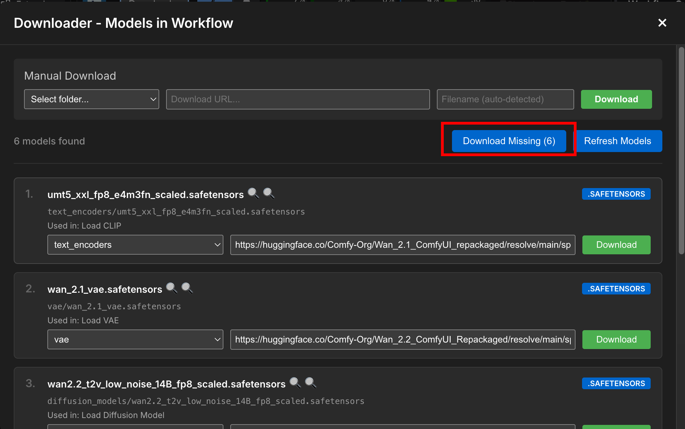

# ComfyUI-Downloader

A powerful and user-friendly extension for ComfyUI that adds a built-in model downloader with a sleek modal interface. Download models, LoRAs, VAEs, and other assets directly from URLs without leaving ComfyUI.

## Features

- 🚀 **High-Speed Downloads**: Uses `wget` on the ComfyUI server for robust large-file downloads
- 📦 **Queue Management**: Download multiple files with automatic queue processing
- 🎯 **Smart Integration**: Detects missing models from your workflow and suggests downloads
- ⚡ **One-Click Missing Downloads**: Queue every missing workflow model from the top-right action bar
- 🔄 **Real-time Progress**: Live progress tracking for queued and active downloads
- 🛡️ **Security**: Built-in path traversal protection and file validation
- 📂 **Auto-Organization**: Downloads files to the correct ComfyUI folders (checkpoints, loras, VAEs, etc.)
- ⏸️ **Download Control**: Cancel downloads in progress with queue management
- 🎨 **Clean UI**: Modal-based interface that integrates seamlessly with ComfyUI


👉 [Watch Full Video](https://github.com/user-attachments/assets/4b9501cc-8017-47f9-9573-93ee6770bdb2)

Models urls are loaded from workflow or https://github.com/Comfy-Org/ComfyUI-Manager/blob/main/model-list.json

## Installation

### Method 2: Manual Installation
1. Navigate to your ComfyUI custom nodes directory:
   ```bash
   cd ComfyUI/custom_nodes/
   ```

2. Clone this repository:
   ```bash
   git clone https://github.com/taigadit/ComfyUI-Downloader.git
   ```

3. Install Python dependencies:
   ```bash
   cd ComfyUI-Downloader
   pip install -r requirements.txt
   ```

4. Install `wget` if your system does not already provide it:
   ```bash
   # macOS (Homebrew)
   brew install wget

   # Ubuntu / Debian
   sudo apt-get install wget
   ```

5. Restart ComfyUI

## Requirements

- Python 3.8+
- ComfyUI
- Dependencies:
- Python package:
  - `aiohttp`
- System dependency:
  - `wget` available in server `PATH`

## Usage

### Basic Usage
1. Click the **"Downloader"** button in the ComfyUI interface (next to the settings button)
2. The downloader modal will open
3. Use **Refresh Models** to scan the current workflow for referenced models
4. To download everything missing at once, click **Download Missing** in the top-right action bar
5. Or paste a model URL in the manual download section for a single file
6. Select the destination folder (checkpoints, loras, vae, etc.)
7. Enter a filename (supports subfolders like `subfolder/model.safetensors`)
8. Click **Download**

### Advanced Features

#### Subfolder Support
You can organize downloads into subfolders:
```
my-loras/character-lora.safetensors
sdxl/checkpoints/my-model.safetensors
```

#### File Override Protection
- If a file already exists, you'll be prompted for confirmation
- Choose to override or cancel the download

#### Missing Model Detection
- The extension scans your workflow for missing models
- Missing models are highlighted in the UI for quick downloading
- The **Download Missing** button queues every missing model that already has a URL and folder configured
- If any missing model does not have a URL or folder, the batch action stops immediately and shows which entries need to be fixed first

Example of the batch download controls in the top-right action bar, with the **Download Missing** button highlighted:



#### Queue Management
- Multiple downloads are queued automatically
- One download processes at a time for optimal performance
- Cancel queued or active downloads anytime
- Batch downloads reuse the same queue, so one-click actions stay in order with manual downloads

## Configuration

The extension shells out to `wget` for the actual file transfer and polls the output file to report progress back to the UI.

## Supported Folders

The downloader supports all standard ComfyUI model directories:
- checkpoints
- loras
- vae
- upscale_models
- embeddings
- controlnet
- clip_vision
- And more...

## Security

ComfyUI-Downloader includes multiple security measures:
- Path traversal attack prevention
- Filename validation (no backslashes, dots, or escape sequences)
- Path resolution verification
- Only downloads to configured ComfyUI model directories

## API

The extension provides REST API endpoints for programmatic access:

### Start Download
```
POST /{API_PREFIX}/server_download/start
{
  "url": "https://example.com/model.safetensors",
  "save_path": "checkpoints",
  "filename": "model.safetensors",
  "override": false
}
```

### Cancel Download
```
POST /{API_PREFIX}/server_download/cancel
{
  "download_id": "checkpoints/model.safetensors"
}
```

### WebSocket Events
- `server_download_progress`: Real-time progress updates
- `server_download_complete`: Download completion notification
- `server_download_error`: Error notifications

## Development

### Project Structure
```
ComfyUI-Downloader/
├── assets/                # README screenshots
├── __init__.py              # Main extension logic and API endpoints
├── requirements.txt         # Python dependencies
├── web/
│   ├── css/
│   │   └── downloader.css  # UI styling
│   └── js/
│       ├── downloader.js   # Extension initialization
│       └── UI.js           # Modal UI implementation
└── README.md
```

### Building and Testing
1. Make your changes
2. Restart ComfyUI to reload the extension
3. Test in the browser console for any errors

## Troubleshooting

### Button Doesn't Appear
- Ensure ComfyUI is fully loaded before looking for the button
- Check browser console for JavaScript errors
- Verify the extension is in the `custom_nodes` directory

### Downloads Fail
- Check internet connectivity
- Verify the URL is accessible
- Check browser console and ComfyUI terminal for error messages
- Ensure you have write permissions to the ComfyUI directories
- If **Download Missing** stops immediately, fill in the missing URL or folder shown in the alert and try again

### Slow Download Speeds
- Download performance depends on the remote host and your server network path
- Check that `wget` is installed and accessible from the ComfyUI process
- Check your network bandwidth and latency

## Contributing

Contributions are welcome! Please feel free to submit a Pull Request.

## License

MIT License - see LICENSE file for details

## Credits

Created for the ComfyUI community to make model management easier and more efficient.

## Support

If you encounter issues or have suggestions:
- Open an issue on GitHub
- Check existing issues for solutions
- Provide error messages and browser console logs when reporting bugs
